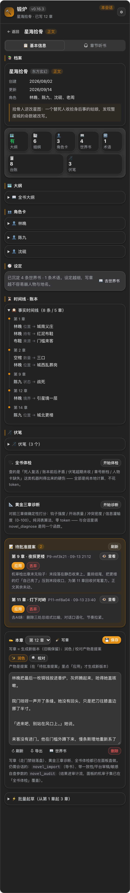
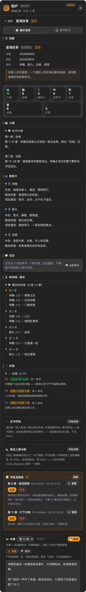

# dsh-novel-forge · Novel Forge

> English ｜ [中文文档](./README.md)

  [](https://github.com/huangziyuan-general/dsh-novel-forge/actions/workflows/ci.yml)

A novel-writing plugin for DeepSeek Harness (DSH). It has exactly one design spine:

> **Code enforcement beats prompt discipline.** Any constraint that relies on the model "behaving itself" will eventually fail —
> consistency, gating, and auditing must be hard constraints at the tool/data layer.

## UI Tour

The right-sidebar "Forge" panel, rendered from the real `lib/client.js` (these are **fictional sample data**, not real books):

| | |
| --- | --- |
| **Project list**<br> | **Detail · Overview** (full-book health dashboard)<br> |
| **Polish guard rejects** (core selling point: code says no, with full reasons)<br> | **Batch drafting** (concurrent gen · serial gating · checkpoint resume)<br> |
| **Chapter text-to-speech**<br> | **Worldbook**<br> |

> The screenshots above are **real renders** of `lib/client.js` (not hand-drawn mocks): run `npm run preview` to generate the preview page, then `assets/mockups/shoot-real.cjs` to reproduce — both light and dark themes track the host.

The failure modes of AI long-form writing aren't magic — each has an engineering answer. This plugin encodes the parts with a clear right/wrong into code:

| AI writing failure mode | This plugin's hard constraint | Entry point |
| --- | --- | --- |
| Setting / power-scaling collapse | Fact ledger: same-chapter value change = conflict rejection; worldbook keywords auto-injected | `novel_ledger` / `novel_worldbook` |
| Model "can't see prior text" | Pre-write briefing assembles a context pack within budget (outline → character cards → ledger → foreshadowing → worldbook → previous chapter ending) | `novel_briefing` |
| Skipping stages verbally | Stage gate: if the chapter outline isn't approved, `novel_write_chapter` rejects outright | `novel_outline approve` |
| Cross-chapter repetition / padding | 8-character shingle overlap detection against prior text; beyond threshold, save is rejected | `novel_write_chapter` mechanical check |
| Uncontrolled chapter length | Mechanical-check threshold defaults to 2000–4000 chars (serial-web novel standard, target 3000); the pre-write briefing carries a "target chapter length" section | `novel_write_chapter` / `novel_briefing` |
| No hook at chapter end | Chapter-end hook heuristic (question / suspense / ellipsis / exclamation); missing one raises a warning | `novel_audit` |
| AI smell | Eight-dimension structural scan: template sentences / stock-phrase density / emotional directness / sentence-pattern templates / paragraph-rhythm variance / information dilution / chapter-end formula / AI default words (fully local, zero model cost) | `novel_noai_scan` |
| Silent overwriting of text | Proposal system: edits go through a proposal → user confirms → new version is generated; old versions are never overwritten | `novel_propose` |
| Lax reviewing | Mechanical and model review are separated: the audit produces deterministic numbers, and model review must cite evidence | `novel_audit` |
| Spoiling the suspense early | Scene contract: hidden-character dossiers never enter context (traces erased even from ledger/summaries); if the name appears in the body, the content gate rejects it | `novel_scene` |
| Drifting from / missing the outline | Outline contract sections (must-write scenes / forbidden deviations) are scored by code for coverage and deviation; hitting a forbidden item rejects the commit | `novel_write_chapter` |
| Every character sounds the same | Voice-gene cards are injected structurally (sentence length / logic / catchphrases / never-says / small gestures / register); review checks against taboo words | `novel_character voice` |
| Context explosion in long works | When a contract is present, only cards of characters appearing in this chapter are injected; worldbook is fetched by whitelist | `novel_briefing` |
| Wanting to outline before settings are set | Nine-stage state machine: each stage's entry condition is judged by code, and what's missing is listed directly | `novel_project phase` |
| Chapter one comes out too short | The outline is scored on scene count + beats (calibrated on 151 real chapters); if it can't reach the floor it is rejected, naming which scene has only one beat; the pre-write briefing then gives a per-scene word budget |
| Editing in the panel bypasses the gates | The panel's save button shares **the same judgment chain** as chapter writing (only the outline stage gate is waived): short drafts, placeholders, resurrected characters and spoilers return 409 with the original text, with one explicit "save anyway (audited)" when needed | panel editor |
| Same chapter keeps going wrong | Circuit breaker: 3 consecutive rejections on the same chapter triggers a write-block (not a reminder); cleared automatically once the outline/contract is fixed | `novel_write_chapter` |
| Doesn't fit platform taste | Two platform review tables: Qidian checks structure / chapter-end hook / mobile paragraph length; Fanqie checks the first 1000 chars for payoffs / face-slaps / frustration pacing | `novel_audit platform` |
| Crossing platform red lines | Seven-category sensitivity self-check; hits return line numbers and fixes | `novel_audit censor` |
| Internal chores flood the main chat | Side-channel direct calls: polish / proofread / annotate / draft run on independent flows — no main-chat occupation, no session-log writing; results surface only as proposals | `lib/engine.js` |
| Batch drafting bypassing gates | Concurrent generation, serial commit: every chapter still passes the same gate; a single-chapter failure doesn't roll back the whole batch | `draft-batch` |
| Batch drafting interrupted midway | Checkpoint: after each chapter commits, `.novel/batch-checkpoint.json` is written; `resume:true` continues from the checkpoint — committed chapters are skipped automatically, only unfinished ones retry | `draft-batch resume` |
| Same session keeps getting shorter | Session-fatigue detection: first drafts declining within the session (second half < 75% of the first half), or a session average under 70% of other sessions' first drafts, or ≥8 consecutive chapters in one session, triggers a warning; "create new session and hand off" builds a new session in one click (with archiving if available), and the handoff summary auto-copies to clipboard | Panel fatigue banner |
| "Can't see prior text" after 100 chapters | Local search index: retrieves paragraphs by memory fragments (manual Chinese bigram segmentation, zero dependencies) | `novel_search` |

## Quick Start (~5 minutes)

**Prerequisites**: [DeepSeek Harness](https://github.com/deepseek-ai) (DSH) installed with a working model; Node ≥ 22 (22.19+ / 24+ enables the search index, otherwise it auto-degrades without affecting other features).

**Step 1 · Install the plugin** (pick one):

```bash
# from npm (published since 0.16.0; installs count toward dshmarket's "Most installed" board)
dsh plugin --profile web add npm:dsh-novel-forge

# from a public GitHub repo (⚠️ the github: shorthand goes through pnpm → SSH:
# the machine needs a GitHub SSH key plus github.com in ~/.ssh/known_hosts, otherwise
# updates fail with "Host key verification failed"; without SSH, use the npm source
# above — pulling a public package needs no credentials at all)
dsh plugin --profile web add github:huangziyuan-general/dsh-novel-forge

# local dev (symlink, edits take effect immediately)
dsh plugin --profile web add link:/path/to/dsh-novel-forge
```

**Step 2 · Restart DSH web, then hard-refresh the browser** (the client bundle is snapshotted at process start; without a restart it's as if you never installed it).

**Step 3 · Verify the install**: a standalone "🔨 Forge" tab appears in the right sidebar; in a session, ask the model to "list the novel tools" — you should see 20 `novel_*` tools. The agent preset "Novel Forge" is also auto-deployed to `~/.dsh/.agent-presets/novel-forge/` (skipped if already present, never overwritten; `DSH_NOVEL_FORGE_REDEPLOY=1` forces a redeploy, `DSH_NOVEL_FORGE_SKIP_DEPLOY=1` disables it).

**Step 4 · Create your first book**: just tell the model in a session, e.g.:

> Use novel_project init to create a fantasy book titled "Example Title", with the one-line premise "a good-for-nothing awakens a power that was never meant to be his".

**Step 5 · Follow the nine stages**: the model guides you through premise → setting → characters → outline → volumes → chapter outlines → body, in order; at each stage it directly lists what's missing. You must `novel_outline approve` the chapter outline before writing it — that's by design, not a bug.

**Step 6 · Collect results in the panel**: in the right-sidebar "Forge" tab you can read / listen, click polish / proofread (outputs are **proposals** — you click "apply" in the panel to make them take effect), run the full-book health check, and export the whole book.

Host version requirements and the dependency surface are in [COMPATIBILITY.md](./COMPATIBILITY.md).

## Division of labor: session vs. panel

- **In a session (model + `novel_*` tools)**: all creative actions — create book, outline, detailed outline, write chapter, ledger, audit. Writing a chapter must go through the session (briefing + multi-stage commit gates form a multi-turn loop).
- **Panel (right-sidebar "Forge")**: read & listen, polish / proofread (side-channel engine, outputs proposals), full-book health check, golden-three-chapter diagnosis, batch drafting (with checkpoint resume), proposal approval (apply / discard), book-card management (rename / delete / clone), session-fatigue monitoring & one-click handoff.

Typical session flow:

```text
novel_project init → novel_project phase (see the nine-stage board, fill entry conditions per the prompts)
→ novel_outline save_book → novel_character save (build a voice-gene card)
→ novel_worldbook add (lock in core settings) → novel_project phase stage:outline/volume (volumes)
→ loop:
    novel_outline save_chapter + approve
    → novel_briefing (get the context pack; if a scene contract exists, trim by it)
    → draft per the outline → novel_write_chapter (gate / mechanical check / ledger / content gate / contract metrics / circuit breaker / commit)
    → novel_noai_scan + novel_audit (evidence) → you (or the model, citing evidence) review
    → before publishing: novel_audit platform:qidian|fanqie + novel_audit censor:true
    → revisions: novel_propose propose → user confirms in panel → v2 generated (old version never overwritten)
```

## Panel feature overview

| Feature | Entry | Description |
| --- | --- | --- |
| Project list | "🔨 Forge" tab | filtered by **session** (projects follow the session); rename / delete / clone; filter box appears above 8 books |
| Claim old books | bottom of list | books built before 0.5.0 with no owner, claim to current session in one click |
| 📋 Overview | detail page | archive / outline / character cards / timeline summary; read chapter (📖 reading card), save, **export**, **golden-three-chapter diagnosis** |
| 🎧 Chapter TTS | detail page | TOC + continuous speech (pause / resume / stop, auto-advances to next chapter when done); each row has 📖 read / ▶ speak, reading and listening are independent |
| One-click polish / mechanical proofread | chapter | runs through the side-channel engine, output is a **proposal**, doesn't touch the body directly; proofread guard is stricter (length cap 1.06) |
| Full-book health check | detail page | dead-character revival / ledger contradictions / overdue foreshadowing / chapter-number gaps / missing character cards, zero token |
| Golden-three-chapter diagnosis | overview card | four-axis numbers (hook / opening / conflict / infodump) + overall verdict, pure wordlist, zero token |
| Batch drafting | detail page | concurrent generation, serial commit; per-chapter success/failure laid out; concurrency cap 4, default 1; after interruption "continue last batch (chapters a–b, N committed)" resumes from checkpoint |
| Session fatigue & handoff | detail-page banner | within-session first-draft decline / session average under 70% of other sessions' first drafts / ≥8 consecutive chapters triggers a warning (the write-progress card carries a session-status line, labelled "first draft = pre-gate draft"); "create new session and hand off" builds + archives a new session in one click, handoff summary auto-copies to clipboard, paste into the new session to continue seamlessly |
| Proposal approval | detail page | view full proposal → apply (generate new version) / discard; old version never overwritten |

## 20 tools

| Tool | Responsibility | Hard constraint |
| --- | --- | --- |
| `novel_project` | init / status / **phase (nine-stage board & entry judgment)** / set_stage / repair / check / promise | prevents duplicate creation; stage entry judged by code; out-of-order recorded as skipped; repair reconciles index vs disk |
| `novel_outline` | full-book outline / chapter-N detailed outline / **approve** | the key to the write-chapter gate |
| `novel_character` | character cards + **voice-gene cards** (voice: sentence length / logic / catchphrases / never-says / small gestures / register, structured storage) | injected as a block when writing; audit voice:true checks taboo words |
| `novel_worldbook` | worldbook entries (add/update/list/remove + import/export) | settings only recognized here; update preserves id; a missing trigger no longer errors — known entity names are derived from the content, otherwise the entry becomes always-on with a visible warning |
| `novel_scene` | scene contract (save/get/list/delete): this-chapter scenes / cast / **hidden characters** / worldbook whitelist / forbidden items | hidden-character dossiers never enter context and their names are forbidden in the body; off-contract characters aren't injected (saves tokens) |
| `novel_briefing` | pre-write context pack (outline → pledge → **scene contract** → character cards → **voice-gene cards** → ledger → foreshadowing → worldbook → previous chapter ending → anchor segments) | consistency supply side; trims cast and worldbook by contract |
| `novel_write_chapter` | write & commit chapter | gate → mechanical check → ledger → **content gate (six dims)** → **outline-contract metrics** → versioning; contract metrics persisted to chapter index |
| `novel_ledger` | fact ledger (with notes) + **point-in-time simulation** (`status_at` snapshot of chapter n / `timeline` evolution) + foreshadowing plant / payoff / reschedule | same-chapter value change rejected; chapter-number-ahead rejected; overdue foreshadowing warned; backfill doesn't alter history |
| `novel_noai_scan` | eight-dimension anti-AI-smell scan | fully local, zero cost |
| `novel_audit` | deterministic chapter audit + contract metrics + `continuity` whole-book consistency + `voice` voice-gene check + `platform` **Qidian / Fanqie dual-platform review** + `censor` **seven-category sensitivity self-check** | mechanical evidence; platform health table gives actionable fixes |
| `novel_style` | prose six-axis baseline (μ±σ band) + **mood spectrum 12 axes**: build baseline / check against (incl. dominant-mood drift) | fully local, zero cost; reports numbers only, no labels |
| `novel_propose` | proposal / list | edits go through proposals, user applies in panel; old versions never overwritten |
| `novel_import` | local book import (preview/import/**backfill gate replay**; file supports `.md`/`.txt`/`.docx` — docx split by Word heading styles and "Chapter N" rules) | pure-function chapter split; create book + versioned commit; docx uses `readBytes` byte channel (text channel corrupts binary), rejects zip64, 48MB decompress cap |
| `novel_export` | export whole book (md/txt + stats) | assembled in version order, written to `导出/` |
| `novel_diagnose` | golden-three-chapter four-axis diagnosis (hook / opening / conflict / infodump) | deterministic numbers, mechanical and model review separated |
| `novel_polish` | paragraph-level lesion localization + polish proposal submission | polish also uses proposals, never overwrites old text |
| `novel_search` | long-work search (build / query / annotate / status): returns chapter number + excerpt + hit ratio | index is a **derivative** (`book/.novel/index.db`), re-runnable after deletion; degrades without sqlite |
| `novel_library` | **book-library feed** (import/list/read/analyze/delete): decompose structural profiles of benchmark works — chapter-length curve / dialogue density / paragraph rhythm / chapter-end hook rate / high-frequency imagery; `compare_book` puts your book side by side with numbers | zero-token fully local; read-only feed, not part of this book's consistency judgment; `delete` only moves the index |
| `novel_glossary` | glossary (add/remove/list) | injected with context pack, prevents proper-noun mistranslation |
| `novel_clone_project` | clone whole book as template | stage reset, proposal and circuit-breaker counters cleared; character cards / worldbook / ledger / foreshadowing / glossary / scene contracts / voice genes all carried along |

> **Parameter convention**: tool parameters deliberately use only scalars (string / integer / boolean); structured data is expressed with delimiter rows
> (e.g. ledger update `entity|key|value[|note]`) — friendly even to small quantized models.

## Data layout (one book = one directory in the session workspace)

```text
我的书/
├─ novel.json            # machine state: nine stages / approvals / chapter index / cast / proposal index / circuit-breaker count
├─ 大纲/全书大纲.md
├─ 大纲/细纲/第3章.md
├─ 人物/林晚.md           # character card (Markdown, injected verbatim into briefing)
├─ 设定/世界书.json        # [{id, keywords[], content, always, priority}]
├─ 设定/术语表.json        # [{term, definition}]
├─ 设定/场景契约.json      # per-chapter cast / hidden characters / worldbook whitelist / forbidden items
├─ 设定/语言基因.json      # per-character: sentence length / logic / catchphrases / never-says / small gestures / register
├─ 正文/第3章-雨夜来客-v2.md   # versioned, never overwritten
├─ 账本/facts.json        # [{entity, key, value, chapter, note}]
├─ 账本/伏笔.json          # [{id, setup, chapter, plan, payoffChapter}]
└─ .novel/
   ├─ audit.jsonl         # full action audit (who did what in which chapter, when rejected)
   ├─ batch-checkpoint.json # batch-draft checkpoint (updated after each chapter commits / is blocked, status: running→done|partial)
   ├─ index.db            # search index (derivative: re-run novel_search build after deletion)
   └─ proposals/P3-xxx.json
```

A `书库/` directory **sibling** to the books may also exist at the workspace root — external novel feed, shared across books
(`library.json` + raw txt; not injected into the context pack, not part of this book's consistency judgment).

All files live inside the session workspace and go through the host's `ctx.fs` (subject to sandbox and approval policy), so they drop straight into Git / Obsidian.
Uninstalling the plugin does not affect any book data.

## Configuration (cordis.patch.yml)

| Item | Default | Description |
| --- | --- | --- |
| minChapterChars | 2000 | per-chapter lower bound (mechanical-reject line, serial-web standard) |
| maxChapterChars | 4000 | per-chapter upper bound (over prompts to split) |
| contextBudgetChars | 6000 | pre-write briefing context-pack budget |
| scanTopK | 8 | max problems listed per dimension in scan report |
| repetitionWindow | 10 | sliding window for cross-chapter repetition detection (compare against previous N chapters) |
| skipPresetDeploy | false | skip preset deploy |
| engine.channels.\* | inherit current route | side channels (polish/proofread/annotate/draft) override per channel; long-text channels (polish/proofread/draft) `timeoutMs` default 600000 |
| engine.channels.\*.maxTokens | 0 | 0 = not passed, inherits host's model-calibrated cap (keep default recommended); setting small explicitly gets burned through by the reasoning model's thinking + full rewrite (reports `OUTPUT_TRUNCATED`) |
| engine.retries | 2 | exponential backoff retries for side-channel calls |
| engine.attachSession | false | whether the side-channel flow writes to the session log; default off (that's what "doesn't occupy the main chat" means) |

> The entire `engine` block can be omitted — omitting means "use the current route, retry 2×, don't write session", the most worry-free default.
> The plugin still loads when the host has no model service; only when a side channel is actually called does it return a readable error.

## Dual MCP channel (reuse outside the host)

The same set of `novel_*` tools (gates / ledger / audit / baselines all live at the tool layer) can also be exposed via stdio MCP to
any MCP client such as Claude Desktop / Cursor — the workspace root takes `NOVEL_FORGE_ROOT`
(defaults to the process cwd), and one novel = one directory in the workspace:

```json
{
  "mcpServers": {
    "novel-forge": {
      "command": "node",
      "args": ["/path/to/dsh-novel-forge/mcp/server.mjs"],
      "env": { "NOVEL_FORGE_ROOT": "/your/novel/workspace" }
    }
  }
}
```

Zero-dependency implementation (native JSON-RPC 2.0 over stdio); the fs backend outside the host carries the same
containment and version-guard semantics (including the `readBytes` byte primitive — `.docx` import works over the MCP channel too).

## Troubleshooting FAQ

| Symptom | Fix |
| --- | --- |
| No "🔨 Forge" tab in the right sidebar | Restart DSH web (bundle is snapshotted at process start) → **hard-refresh** the browser. The console should show `[novel-forge] client apply v…` |
| Panel button does nothing when clicked | Hard-refresh first; check the console for `[novel-forge]` logs. Developers can run the button sweep in `npm run preview` to locate it |
| Polish / proofread returns `503 engine not ready` | The current dsh process has no usable model service: confirm the model route is configured, the plugin is the latest build, and it has been restarted to take effect |
| Polish / proofread returns `NO_PARENT_AGENT` | The plugin first tries to auto-materialize by the "book's owning session" candidate; if that still fails, send a message in the session that owns the book (so the session agent stays resident), then retry from the panel |
| Polish returns `OUTPUT_TRUNCATED` | Model output was cut off by the cap. Keep `engine.channels.*.maxTokens` at the default 0 (inherits the host-calibrated value); don't set it small explicitly |
| Write rejected "outline not approved" | Run `novel_outline approve` first. To force-skip use `force` (logged to audit), not recommended |
| Write rejected "chapter N circuit-breaker active" | Triggered by 3 consecutive rejections on the same chapter. Go fix the outline or scene contract; the counter clears automatically once done |
| Mechanical check says "no chapter-end hook" but there clearly is one | The last character of the chapter must be a bare `？` / `！` / `……` — a following closing quote (" / 」) causes a miss |
| Mechanical check says "dialogue ratio 0" | Use Chinese curly quotes "" for dialogue in the body; corner brackets aren't recognized |
| Outline coverage 0% but the scene was written | Coverage matches the outline's "must-write scene" titles lexically (heuristic); align the scene title wording with the outline entry |
| "One-click write chapter" button 501 | By design: writing a chapter requires the briefing + multi-stage commit gates, and can only be done in a session |
| "Continue last batch" returns 409 `BATCH_RUNNING` | The last batch may still be running: wait for it to finish, or only resume after >10 minutes (anti-double-run guard; a stale checkpoint from a web restart auto-releases after timeout) |
| Panel returns 403 `FORBIDDEN_HOST` | The access address isn't localhost (you used a LAN IP or domain) — the panel API only allows localhost/127.0.0.1/[::1]; open DSH web with a local address (see "Known boundaries" for the security model) |

## Development and testing

```bash
npm run setup-dev   # symlink the host SDK real package from a DSH checkout into local node_modules
npm run build       # src/client/ → lib/client.js (must run after editing client source; npm test runs it automatically)
npm run audit       # static self-check: ① called-but-not-imported/declared ② orphan dataset.X reads (also run as npm test pre-step)
npm run preview     # generate interactive UI preview preview/forge-ui.html (inlines real build + real host token, opens offline)
npm test            # node --test full suite (pure-logic unit + fake-fs full-chain smoke + REST behavior + real-validator output contract + headless behavior; count in the tests badge above)
node scripts/demo.mjs   # end-to-end demo: init → outline → write → ledger → scan → propose full flow
```

Development conventions (pure-logic/io separation, output.schema field-by-field consistency, peerDependencies, client source/build separation,
the three-step panel-entry contract, etc.) are in [AGENTS.md](./AGENTS.md).

## Known boundaries

- **Panel REST is localhost-only** (security model, since 2026-10-09): the API relies on two browser-unforgeable defenses — the `x-dsh-novel-forge` fence header blocks ordinary cross-origin, and the `Host`/`Origin` allowlist (`localhost`/`127.0.0.1`/`[::1]`) blocks DNS rebinding. The cost is **localhost restriction**: changing the port is fine (port isn't in the check), an SSH tunnel is fine (Host stays 127.0.0.1), but if you expose DSH web to a LAN and access it from another machine, the Forge panel API will 403 (`FORBIDDEN_HOST`). The fence gives zero protection against other local processes — that's a design assumption (the threat model is a malicious web page in the browser, not a local process).
- The anti-AI-smell wordlist and thresholds are **heuristic** — they catch only visible symptoms and don't promise a "cure"; the structural metrics (rhythm variance / information dilution) are what make it stronger than a pure wordlist.
- `novel_audit` only produces deterministic evidence; "model review" happens in the session; the side-channel engine only serves internal chores (polish / proofread / annotate / draft) and doesn't change the line that "audit tools don't call the model".
- Batch-draft concurrency cap is **4** (default 1; forced down to 1 when the book has no scene contract); concurrency only applies to drafting, commit is always serial.
- `novel_search` is **lexical retrieval + LLM label enhancement**, not embedding semantic retrieval; the index is a single-file sqlite, not stress-tested on 100k-block mega-books; `annotate` incurs real token cost (default at most 20 blocks per run).
- Cross-chapter repetition detection is a sliding window (default previous 10 chapters, adjustable) — repetition beyond the window isn't caught; worldbook recursive activation is capped at 2 rounds.
- Panel TTS uses Web Speech synthesis, with body chunking to prevent Chrome long-text stalls; environments without a speech engine return a readable error.

## License

See [LICENSE](./LICENSE).
