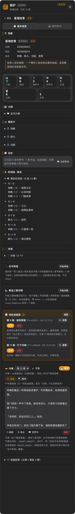
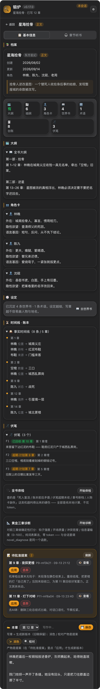

# dsh-novel-forge · 小说锻炉

> 中文文档 ｜ [English](./README.en.md)

  [](https://github.com/huangziyuan-general/dsh-novel-forge/actions/workflows/ci.yml)

DeepSeek Harness（DSH）的中文长篇写作插件。它不是「提示词合集」，而是把**一致性、门禁、审计**做进工具层与数据层：模型负责动笔，插件负责把写坏、写歪、写穿的地方拦在落盘之前。

**适合谁：** 多角色 / 多卷 / 连载几十上百章、会被「设定崩了」「前文失忆」「悬念泄底」「AI 味太重」卡住的长篇作者。

**一句话卖点：** 关键约束全部代码化——同章改值=冲突拒绝、隐藏人物不进上下文、细纲漏写场景=拒稿、旧版永不覆盖、长篇检索零依赖本地跑。

[快速开始](#快速开始约-5-分钟) ｜ [界面一览](#界面一览) ｜ [功能硬约束表](#ai-写作通病与硬约束) ｜ [24 个工具](#24-个工具)

## 为什么不是又一个「提示词合集」

多数写作插件的约束写在系统提示里——模型心情好就守，赶进度就绕。本插件的设计主线只有一条：

> **代码强制 > 提示词自觉。** 凡是「靠模型自觉」的约束都会失效；一致性、门禁、审计必须是工具层/数据层的硬约束。

三条可在仓库里对着源码核的事实：

1. **三条入口共用一份判定链**：面板「💾 保存」、`novel_write_chapter`、REST 写入走同一套门禁代码（机审/账本冲突/内容门禁/细纲契约）——没有旁路；唯一的放行开关显式记审计。
2. **模型无法自批提案**：修订提案模型只能登记、不能应用——「应用」是面板里用户的主权动作（模型侧没有 apply 工具）；细纲批准记录批准通道，看板统计「工具自批占比」（真机实证某连载本曾 168/168 全自批，正是大纲漂移的第一缺口）。
3. **审计零 token**：机审、去 AI 味扫描、平台审稿、一致性校验、账本时点推演全部是纯本地计算——逐章审计成本为 0，数字不经过模型之手。

[](https://star-history.com/#huangziyuan-general/dsh-novel-forge&Date)

## 界面一览

右侧栏「锻炉」面板实机渲染（以下均为**虚构示例数据**，非真实书目）：

| | |
| --- | --- |
| **项目列表**<br> | **详情 · 基本信息**（全书体检仪表盘）<br> |
| **润色守卫拦下**（核心卖点：代码拒绝，理由给全）<br> | **批量起草**（并发生成·串行过门禁·断点续跑）<br> |
| **章节听书**<br> | **世界书**<br> |

> 以上是 `lib/client.js` 的**真实渲染**（非手绘 mock）：`npm run preview` 生成预览页后跑 `assets/mockups/shoot-real.cjs` 即可复现，浅色/深色两套随宿主主题。

> 看完了演示觉得有用？这就是它每天在你写长篇时替你挡下的事。顺手点个 ⭐ 让更多人看见：
> [github.com/huangziyuan-general/dsh-novel-forge](https://github.com/huangziyuan-general/dsh-novel-forge)

## AI 写作通病与硬约束

AI 长篇写作的通病不是玄学，每一个都有对应的工程解法。本插件把其中「有明确对错」的部分做进代码：

| AI 写作通病 | 本插件的硬约束 | 落点 |
| --- | --- | --- |
| 设定/战力崩坏 | 事实账本：同章改值=冲突拒绝；世界书关键词自动注入 | `novel_ledger` / `novel_worldbook` |
| 模型"看不见前文" | 写前简报按预算组装上下文包（细纲→人物卡→账本→伏笔→世界书→上章结尾） | `novel_briefing` |
| 口头跳阶段 | 阶段门禁：细纲未批准，`novel_write_chapter` 直接拒绝 | `novel_outline approve` |
| 跨章复读/水文 | 8 字 shingle 与前文重复检测，超阈值拒绝保存 | `novel_write_chapter` 机审 |
| 章节字数失控 | 机审门槛默认 **2000–4000 字**（网文连载单章标准，目标 3000）；写前简报带「本章字数目标」段 | `novel_write_chapter` / `novel_briefing` |
| 章末无钩子 | 章末钩子启发式（问句/悬念/省略/感叹），缺了给警告 | `novel_audit` |
| AI 味 | 八维结构性扫描：模板句/库存词密度/情绪直写/句式模板/段落节奏方差/信息稀释/断章公式/AI 默认值词（纯本地，零模型费用） | `novel_noai_scan` |
| 偷偷覆盖正文 | 提案制：修订走提案→用户确认→生成新版本，旧版永不覆盖 | `novel_propose` |
| 审稿放水 | 机审与模型审分离：审计产出确定性数字，模型审稿必须引用证据 | `novel_audit` |
| 悬念提前泄底 | 场景契约：隐藏人物**档案不进上下文**（连账本/摘要里的痕迹也擦掉），正文出现其名=内容门禁拦下 | `novel_scene` |
| 写偏/漏写细纲 | 细纲契约段（必写场景 / 禁止偏离项）由代码算覆盖率与偏离度，命中禁项拒绝落盘 | `novel_write_chapter` |
| 多角色千人一腔 | 语言基因卡结构化注入（句长/逻辑/口头禅/绝不说/小动作/语域），审稿核对禁忌词 | `novel_character voice` |
| 长篇上下文爆炸 | 契约在场时只注入本章出场人物的卡，世界书按白名单取 | `novel_briefing` |
| 设定没定就想写大纲 | 九阶段状态机：每阶段入场条件由**代码**判定，缺什么直接列出来 | `novel_project phase` |
| 第一章就写不够字数 | 细纲按「场景数 + 拍数」估算本章能写多少（真机 151 章标定），撑不到下限就驳回并点名哪个场景只有一拍；写前简报再给**逐场景字数预算** |
| 面板改稿绕过门禁 | 面板「💾 保存」与写章**共用同一套判定**（只豁免细纲流程门禁）：短稿/占位符/死人复活/泄底一律 409 并摆出原文，需要时给一次显式「仍要保存（记审计）」 | 面板编辑区 |
| 同一章反复写不对 | 熔断：同章连续驳回 3 次即**拒写**（不是提醒），改完细纲/契约自动解除 | `novel_write_chapter` |
| 不合平台口味 | 平台审稿五张表：起点看结构/章末钩子/移动端段长，番茄看前 1000 字爽点/打脸/憋屈时长，晋江看字数足额/开篇忌虐，七猫看强情绪快节奏/章末钩子，飞卢看极快节奏/金手指前置/爽点密度 | `novel_audit platform` |
| 踩平台红线 | 敏感自查七类，命中给行号与改法 | `novel_audit censor` |
| 内部工序占满主对话 | 旁路直调：润色/校对/打标/起草走独立流，不占主对话、不写会话记录；结果只出提案 | `lib/engine.js` |
| 批量起草绕过门禁 | 并发生成、**串行提交**：每章仍过同一道门禁，单章失败不回滚整批 | `draft-batch` |
| 批量起草中途断了 | 断点检查点：每章提交后落盘 `.novel/batch-checkpoint.json`，`resume:true` 从断点续跑——已落盘章自动跳过、只重试未完成的 | `draft-batch resume` |
| 同一会话连写越写越短 | 会话疲劳检测（同口径）：本会话**首稿逐章变短**（后半 < 前半 75%）、或首稿均值低于其它会话首稿 70%、或连写 ≥8 章即警示；「创建新会话并交接」一键建新会话（有归档能力就建+归档一次完成），交接摘要自动进剪贴板 | 面板疲劳横幅 |
| 写到百章后"看不见前文" | 本地检索索引：按**记忆碎片**把段落找回来（中文手工二元切分，零依赖） | `novel_search` |

## 快速开始（约 5 分钟）

**前提**：已安装 [DeepSeek Harness](https://github.com/deepseek-ai)（DSH）并跑通模型；Node ≥ 22（22.19+ / 24+ 可启用检索索引，否则自动降级，不影响其他功能）。

**第 1 步 · 安装插件**（任选其一）：

```bash
# 从 npm（0.16.0 起已发布；安装量计入 dshmarket「Most installed」榜）
dsh plugin --profile web add npm:dsh-novel-forge

# 从 GitHub 公开仓库（⚠️ github: 简写经 pnpm 走 SSH——机器要配好 GitHub SSH key
# 且 ~/.ssh/known_hosts 里有 github.com 主机指纹，否则更新报 Host key verification failed；
# 没配 SSH 就用上面的 npm 源，公共仓库拉取无需任何凭据）
dsh plugin --profile web add github:huangziyuan-general/dsh-novel-forge

# 本地开发（符号链接，改码即生效）
dsh plugin --profile web add link:/path/to/dsh-novel-forge
```

**第 2 步 · 重启 DSH web，然后浏览器硬刷新**（客户端 bundle 在进程启动时快照，不重启等于没装）。

**第 3 步 · 验证安装**：右侧栏出现「🔨 锻炉」独立 tab；在会话里让模型「列出小说工具」，应能看到 24 个 `novel_*` 工具。同时 agent 预设「小说锻炉」已自动部署到 `~/.dsh/.agent-presets/novel-forge/`（已存在则跳过，永不覆盖；`DSH_NOVEL_FORGE_REDEPLOY=1` 强制重铺，`DSH_NOVEL_FORGE_SKIP_DEPLOY=1` 关闭）。

**第 4 步 · 建第一本书**：在会话里直接对模型说，例如：

> 用 novel_project init 建一本玄幻书《示例书名》，一句话立意是「废柴觉醒了不该属于他的力量」。

**第 5 步 · 跟着九阶段走**：模型会按 立意→设定→人物→大纲→分卷→细纲→正文 的顺序引导，每个阶段缺什么、插件会直接列出来。写章前必须先 `novel_outline approve` 批准该章细纲——这是设计，不是故障。

**第 6 步 · 到面板收结果**：右侧栏「锻炉」tab 里阅读/听书、点润色/校对（产物是**提案**，你在面板点「应用」才生效）、跑全书体检、导出整本。

宿主版本要求与依赖面清单见 [COMPATIBILITY.md](./COMPATIBILITY.md)。

## 会话与面板的分工

- **会话里（模型 + `novel_*` 工具）**：一切创作动作——建书、大纲、细纲、写章、账本、审计。写章必须走会话（简报 + 多道落盘门禁是多轮闭环）。
- **面板（右侧栏「锻炉」）**：阅读与听书、润色/校对（旁路引擎，产物为提案）、全书体检、黄金三章诊断、批量起草（含断点续跑）、提案审批（应用/丢弃）、书卡管理（改名/删除/克隆）、会话疲劳监测与一键交接。

典型会话流：

```text
novel_project init → novel_project phase（看九阶段看板，按提示补齐入场条件）
→ novel_outline save_book → novel_character save（建语言基因卡）
→ novel_worldbook add（固化核心设定）→ novel_project phase stage:outline/volume（分卷）
→ 循环：
    novel_outline save_chapter + approve
    → novel_briefing（拿上下文包；有场景契约就按契约裁剪）
    → 按细纲成稿 → novel_write_chapter（门禁/机审/账本/内容门禁/契约指标/熔断/落盘）
    → novel_noai_scan + novel_audit（证据）→ 你自己（或让模型引用证据）审稿
    → 发书前：novel_audit platform:qidian|fanqie|jjwxc|qimao|feilu + novel_audit censor:true
    → 修订：novel_propose propose → 用户在面板确认 → 生成 v2（旧版永不覆盖）
```

## 面板功能一览

| 功能 | 入口 | 说明 |
| --- | --- | --- |
| 项目列表 | 「🔨 锻炉」tab | 按**会话**过滤（项目跟会话走）；改名/删除/克隆；>8 本出筛选框 |
| 认领旧书 | 列表底部 | 0.5.0 之前建的无归属书，一键认领到当前会话 |
| 🎛 创作驾驶舱 | 详情页顶部 | 打开书自动聚合进度、体检、大纲、提案、诊断与本书字数口径；“前 3 + 最近 12”章抽样做平台审稿汇总，先看硬伤和下一步动作，再决定继续写或改稿 |
| 📋 基本信息 | 详情页 | 档案/大纲/角色卡/时间线总览；读章（📖 阅读卡）、保存、**导出**、**黄金三章诊断** |
| 🎧 章节听书 | 详情页 | 目录 + 语音连播（暂停/继续/停止、读完自动接下一章）；每行 📖 阅读 / ▶ 朗读，看听独立 |
| 一键润色 / 机械校对 | 章节 | 「☑ 审稿项」可勾选本次处理项并填写作者指导，未选意见不进提示词；走旁路引擎，产物是**提案**，不直接改正文；校对守卫更严（篇幅上限 1.06） |
| 持久批注 | 审稿项 | 引文、段落哈希与邻近上下文共同锚定；正文改版后精确或唯一邻近重定位，不可靠时标失效，不静默猜位置；解决/重开均保留记录 |
| 档案抽取提案 | 详情页提案区 | `novel_extract` 从旧稿提出人物/世界书候选，每项带已核验原文证据；面板逐项编辑、勾选后应用，未选项保留，人工改档冲突不覆盖 |
| 全书体检 | 详情页 | 死人复活/账本矛盾/伏笔超期/叙事契约违约/章号断档/人物卡缺失，零 token |
| 黄金三章诊断 | 基本信息卡 | 钩子/开场/冲突/灌输四维数字 + 总评，纯词表零 token |
| 批量起草 | 详情页 | 并发生成、串行提交；逐章成败、失败阶段/原因、路由、调用次数、耗时与 tokens 写入断点，重开面板仍可查；并发上限 4、默认 1；中断后从断点续跑；上下文超限只降可选材料并重建一次 |
| 失败正文恢复 | 批量起草卡 | 生成失败或门禁驳回的可用正文留作恢复候选；取回只进编辑器，不直接落章，也不覆盖未保存草稿，仍须显式保存并过门禁；候选按保留策略自动清理（最近 20 个 / 30 天） |
| 前章影响 | 章节 | 按写章时记录的来源指纹列出直接、传递及不可判定的后章；只提示复核，不自动重写或定稿 |
| 会话疲劳与交接 | 详情页横幅 | 会话内首稿趋势退化 / 首稿均值低于其它会话 70% / 连写 ≥8 章即警示（写章进度卡带会话状态行，文案标清「首稿＝门禁驳回前的初稿」）；「创建新会话并交接」一键建新会话+归档旧会话，交接摘要自动进剪贴板，粘到新会话即可无缝续写 |
| 提案审批 | 详情页 | 查看提案全文 → 应用 / 丢弃；也可按原稿、提案、当前稿逐段三路合并，冲突默认保留当前稿，版本或哈希变化即拒绝；旧版永不覆盖 |

## 24 个工具

| 工具 | 职责 | 硬约束 |
| --- | --- | --- |
| `novel_project` | init / status / **phase（九阶段看板与入场判定）** / set_stage / repair / check / promise / promise_template / promise_review / preference / platform / chars | 题材模板与偏好存储零 token；`promise_review` 复用 `annotate`，默认复核最近三章、引文逐字核验，只给建议不进门禁；偏好必须经用户明确确认，不能削弱硬约束 |
| `novel_outline` | 全书大纲 / 第N章细纲 / **批准** | 写章门禁的钥匙 |
| `novel_character` | 人物卡 + **语言基因卡**（voice：句长/逻辑/口头禅/绝不说/小动作/语域，结构化存储） | 写章单独注入成区块；audit voice:true 核对禁忌词 |
| `novel_worldbook` | 世界书条目（add/update/list/remove + import/export） | 设定只认这里；update 保 id；缺触发词不再报错——先抽本书已知实体名，抽不到转常驻并给可见警告 |
| `novel_scene` | 场景契约（save/get/list/delete）：本章场景/出场人物/**隐藏人物**/世界书白名单/禁项 | 隐藏人物档案不进上下文且正文不许出现其名；契约外人物不注入（省 token） |
| `novel_briefing` | 写前上下文包（细纲→承诺书→**场景契约**→人物卡→**语言基因卡**→账本→**叙事契约**→伏笔→世界书→上章结尾→锚段→**写作样稿**（表达校准）） | 一致性供给侧；按契约裁剪 cast 与世界书 |
| `novel_write_chapter` | 写章落盘 | 门禁→机审→账本→**内容门禁（六维）**→**细纲契约指标**→版本化；与同章细纲长段逐字重合只告警并记 minor 债，场景摘要和显式原话段豁免 |
| `novel_ledger` | 事实账本（含 note）+ **时点推演**（`status_at` 第 n 章快照 / `timeline` 演化线）+ 伏笔埋/收/改期 + **回收证据校验** + 认知账本 + **叙事契约**（pledge/deadline/secret）+ **写作样稿库**（sample_* 六动作） | 同章改值拒绝；章号超前拒绝；超期伏笔告警；回收章必须已写且正文命中关键词（force 记审计）；契约到期未兑现写章时点名，broken 且仍有到期伏笔未还 → 拒绝落盘；补录不改历史；认知倒退显形 |
| `novel_relation` | 关系账本：人物/组织**之间**的关系状态线（盟友/仇敌/师徒/信任度…）：`update` 登记推进 / `query` 当前值 / `status_at` 时点推演 / `timeline` 演化线 | (A,B) 与 (B,A) 自动归一同一对；同章同对同维度改值=冲突拒绝；正文仍按旧值写 → 内容门禁每章 warning |
| `novel_arc` | 弧线账本：单人物**维度**随章推进（成长/无畏/信任度/嫌疑度…）：`update` 登记推进 / `query` 当前读数 / `status_at` 时点 / `diagnose` 全书停走诊断 | `stalled`（≥15 章未推进）命中时写章链自动落 major 质量债；`no-move`（全书≥20章只推进过一次）warning；零 token 纯函数 |
| `novel_quality` | 书级质量债：`view` 看欠了多少账 / 最重是哪章 / 现在该不该继续写；`settle` 结清某章的债 | 三级口径（minor 质量债 / major 需重规划 / hard 硬门禁放行）；局部瑕疵不阻塞全书，硬门禁放行必须回头核对 |
| `novel_noai_scan` | 八维去 AI 味扫描 | 纯本地零费用 |
| `novel_audit` | 确定性章节审计 + 契约指标 + `continuity` 全书一致性 + `voice` 语言基因核对 + `platform` **起点/番茄/晋江/七猫/飞卢五平台审稿** + `censor` **敏感自查七类** | 机审证据；平台体检表给出可执行改法 |
| `novel_style` | 文笔六维基线（μ±σ 带）+ **氛围光谱 12 轴**：build 建基线 / check 对照（含主导氛围漂移） | 纯本地零费用；只报数不贴标签 |
| `novel_propose` | 提案 / 列表 | 修订走提案，用户在面板应用；旧版永不覆盖 |
| `novel_import` | 本地书籍导入（preview/import/**backfill 门禁回补**；file 支持 `.md`/`.txt`/`.docx`——docx 按 Word 标题样式与「第N章」规则切分） | 纯函数切分章节；建书+版本化落盘；docx 走 `readBytes` 字节通道（文本通道会解坏二进制），拒 zip64、48MB 解压上限 |
| `novel_export` | 导出整本（md/txt + stats） | 按版本顺序拼装，写 `导出/` |
| `novel_diagnose` | 黄金三章四维诊断（钩子/开场/冲突/灌输） | 确定性数字，机审与模型审分离 |
| `novel_polish` | 段落级病灶定位 + 润色提案提交 + 审稿引文 grounding（`review_quotes`） | 润色也走提案制，永不覆盖旧稿；引文必须逐字（忽略空白）在原文里找到，太短/找不到即整章拒收 |
| `novel_search` | 长篇检索（build / query / annotate / status）：返回章号+摘录+命中比例；query 弱结果时**自动查询扩写**（改写多路候选重查合并），写章落盘后**新块自动补语义标签** | 索引是**派生物**（`书/.novel/index.db`），删了重跑即得；无 sqlite 自动退化 |
| `novel_library` | **书库饲料**（import/list/read/analyze/semantic/delete）：`analyze` 拆章长曲线/对话密度/段落节奏/章末钩子率/高频意象；`semantic` 按七个维度提炼技巧与可迁移做法，每条带章节原文证据，另出**特色词库**（特色词 + 出处引文，逐字 grounding） | `analyze` 零 token；`semantic` 复用现有 `annotate` 模型路由（无需新增 key），默认前 3 章、单次最多 5 章/30000 字；JSON 仅做一次保守语法修复且不改证据，修复后仍逐字核对引文，报告写入 `书库/<id>/语义拆书-第N-M章.md`；不参与本书一致性判定 |
| `novel_extract` | 从本书旧稿抽取人物卡、别名与世界书候选（all / character / worldbook） | 复用 `annotate`；每条候选必须有含候选名或别名的逐字原文证据；只创建待批提案，模型不能应用，用户编辑勾选后才写入正式档案 |
| `novel_glossary` | 术语表（add/remove/list） | 随上下文包注入，防专有名词乱译 |
| `novel_clone_project` | 整书克隆为模板 | 阶段重置、批注/提案与熔断计数清空；人物卡/世界书/账本目录整体（facts/伏笔/认知/关系/弧线/契约/样稿）/术语表/场景契约/语言基因/承诺书/本书偏好一并带走 |

> **参数约定**：工具参数刻意只用了标量（字符串/整数/布尔），结构化数据用分隔行表达
> （如账本更新 `实体|键|值[|备注]`）——对量化小模型也友好。

## 数据布局（一本书 = 会话工作区里的一个目录）

```text
我的书/
├─ novel.json            # 机器状态：九阶段/批准/章节索引/cast/提案索引/熔断计数
├─ 大纲/全书大纲.md
├─ 大纲/细纲/第3章.md
├─ 人物/测试角色.md           # 人物卡（Markdown，briefing 原文注入）
├─ 设定/世界书.json        # [{id, keywords[], content, always, priority}]
├─ 设定/术语表.json        # [{term, definition}]
├─ 设定/场景契约.json      # 按章的出场/隐藏人物、世界书白名单、禁项
├─ 设定/语言基因.json      # 按人物：句长/逻辑/口头禅/绝不说/小动作/语域
├─ 设定/故事承诺书.md      # 自由承诺书或本地题材模板；每次写章注入
├─ 正文/第3章-雨夜来客-v2.md   # 版本化，永不覆盖
├─ 账本/facts.json        # [{entity, key, value, chapter, note}]
├─ 账本/伏笔.json          # [{id, setup, chapter, plan, payoffChapter}]
├─ 账本/relations.json     # 人物/组织间关系状态线（盟友/仇敌/师徒/信任度…）
├─ 账本/arcs.json          # 单人物维度随章推进（成长/信任度/嫌疑度…）
├─ 账本/cognition.json     # 认知账本：谁知道什么 / 不知道什么 / 读者已知
├─ 账本/pledges.json       # 叙事契约：pledge/deadline/secret，带到期章号
├─ 账本/样稿.json          # 写作样稿库：认可样稿与注入批准位
└─ .novel/
   ├─ audit.jsonl         # 全动作审计（谁在哪章做了什么、何时被拒）
   ├─ batch-checkpoint.json # 批量断点 + records 逐章状态/错误/调用指标（status: running→done|partial）
   ├─ index.db            # 检索索引（派生物：删了重跑 novel_search build 即得）
   ├─ invocations/         # 幂等回执（重复请求识别；保留最近 200 个 / 30 天）
   ├─ recovery-pruned.json # 已清理恢复候选的有界索引（404 区分已清理与不存在）
   ├─ annotations.json    # 可重定位审稿批注（open / resolved / stale）
   ├─ extraction-proposals.json # 待人工编辑、选择和应用的档案候选
   ├─ preferences.json    # 仅由用户明确确认的本书长期偏好
   ├─ reader-promises.json # 结构化题材清单；手工承诺书会将它清空
   └─ proposals/P3-xxx.json
```

工作区根下还可以有一个与各书目**平级**的 `书库/`——外部小说饲料，多本书共享
（`library.json` + 原文 txt + 可选语义拆书 Markdown 报告；不进本书上下文包、不参与本书一致性判定）。

全部文件都在会话工作区内、走宿主 `ctx.fs`（受沙箱与审批策略约束），可直接进 Git / Obsidian。
卸载插件不影响任何书稿数据。

## 配置（cordis.patch.yml）

| 项 | 默认 | 说明 |
| --- | --- | --- |
| minChapterChars | 2000 | 单章下限（机审拒绝线，网文连载单章标准） |
| maxChapterChars | 4000 | 单章上限（超了提示拆章） |
| contextBudgetChars | 6000 | 写前简报上下文包预算 |
| scanTopK | 8 | 扫描报告每维最多列出的问题数 |
| repetitionWindow | 10 | 跨章重复检测的滑动窗口（与前 N 章比对） |
| skipPresetDeploy | false | 跳过预设部署 |
| engine.channels.\* | 继承当前路由 | 旁路通道（polish/proofread/annotate/expand/draft）按通道覆盖；长文通道（polish/proofread/draft）`timeoutMs` 默认 600000，短任务通道（annotate/expand）默认 512 tok / 60s |
| engine.channels.\*.maxTokens | 0 | 0＝不传，继承宿主按模型校准的上限（推荐保持默认）；显式设小会被推理模型的思考+整章重写烧穿（报 `OUTPUT_TRUNCATED`） |
| engine.retries | 2 | 旁路调用的指数退避重试次数 |
| engine.attachSession | false | 旁路流是否写进会话记录；默认不写（这才是"不占主对话"） |
| allowedHosts | [] | 面板 API 的额外本机白名单：裸主机名数组（不带端口，大小写不敏感，Origin 共用同一集合）；默认空 = 只许 localhost/127.0.0.1/[::1]，与未配置逐字相同；拒通配符 |
| autoOpenPanel | true | 打开 DSH web 时自动展开锻炉 tab；false 只关自动弹出，tab 仍常驻 |
| search.autoAnnotate | true | 写章落盘后自动给本章新块补语义标签（后台执行，封顶 4 块）；false 整体关掉 |

> `engine` 整块都可省略——省略即「用当前路由、重试 2 次、不写会话」，最省心的默认。
> 宿主没有模型服务时插件照常装载，只有真正调用旁路通道时才返回可读错误。

## MCP 双通道（宿主外复用）

同一套 `novel_*` 工具（门禁/账本/审计/基线全在工具层）也可通过 stdio MCP 暴露给
Claude Desktop / Cursor 等任意 MCP 客户端——工作区根取 `NOVEL_FORGE_ROOT`
（缺省为进程 cwd），一本小说 = 工作区里的一个目录：

```json
{
  "mcpServers": {
    "novel-forge": {
      "command": "node",
      "args": ["/path/to/dsh-novel-forge/mcp/server.mjs"],
      "env": { "NOVEL_FORGE_ROOT": "/你的小说工作区" }
    }
  }
}
```

零依赖实现（原生 JSON-RPC 2.0 over stdio；宿主 peer 包缺席也能启动——输出校验
退化为不校验、工具本体照常）；宿主外的 fs 后端带同样的
containment 与版本守卫语义（含 `readBytes` 字节原语——`.docx` 导入在 MCP 通道同样可用）。

## 排障 FAQ

| 症状 | 处理 |
| --- | --- |
| 右侧栏没有「🔨 锻炉」tab | 重启 DSH web（bundle 进程启动时快照）→ 浏览器**硬刷新**。console 应有 `[novel-forge] client apply v…` |
| 面板按钮点了没反应 | 先硬刷新；console 看 `[novel-forge]` 日志。开发者可跑 `npm run preview` 的按钮扫射定位 |
| 润色/校对报 `503 引擎未就绪` | 当前 dsh 进程没有可用的模型服务：确认模型路由已配置、插件是最新构建并已重启生效 |
| 润色/校对报 `NO_PARENT_AGENT` | 插件会先按「书归属会话」候选自动物化；仍失败时，到拥有这本书的会话里发一条消息（让会话 agent 驻留），再回面板重试 |
| 润色报 `OUTPUT_TRUNCATED` | 模型输出被上限截断。保持 `engine.channels.*.maxTokens` 默认 0（继承宿主校准值），不要显式设小 |
| 写章被拒「细纲未批准」 | 先 `novel_outline approve`。确要跳过用 force（记审计），不建议 |
| 写章被拒「第N章熔断中」 | 同章连续驳回 3 次触发。回去改细纲或场景契约，改完计数自动清零 |
| 机审说「章末钩子未检出」但明明有 | 章末最后一个字符必须是裸 `？` / `！` / `……`——后跟闭引号（" / 」）会漏检 |
| 机审说「对话占比 0」 | 正文对话请用中文弯引号 ""，直角引号不识别 |
| 细纲覆盖率 0% 但场景写了 | 覆盖率按细纲「必写场景」标题词面匹配（启发式），把场景标题措辞对齐细纲条目即可 |
| 「一键写章」按钮 501 | 设计如此：写章要走 briefing + 多道落盘门禁，只能在会话里做 |
| 「继续上次批量」报 409 `BATCH_RUNNING` | 上次批量可能还在跑：等它结束，或启动已超过 10 分钟再续（防双跑守卫；web 重启残留的检查点超时后自动放行） |
| 面板报 403 `FORBIDDEN_HOST` | 访问地址不是本机（用了局域网 IP 或域名）——面板 API 只限 localhost/127.0.0.1/[::1]，用本机地址打开 DSH web（安全模型见「已知边界」）。经自有域名访问：在插件配置 `allowedHosts` 数组里加入你的裸主机名（如 `"forge.example.cn"`，不带端口，大小写不敏感；Origin 共用同一集合；默认空 = 只许本机）。SSH 隧道/换端口始终免配置 |
| 面板 tab 每次加载都自动弹开 | 设计如此（锻炉是右侧栏常驻 tab）。不想要自动打开：插件配置 `autoOpenPanel: false`——tab 仍在右侧栏，只是不再自动弹出；配置读取失败按 true 兜底（自动打开是锦上添花，不被服务可用性绑架） |
| 列表里少了一本书，console 有「扫描根不可读」warn | 某个工作区根被 `readdir` 拒了（SELinux/chmod 000/挂载点抖动），本进程已把它剔除——检查该目录的读权限，而不是排查插件。权限类（EACCES/EPERM）会被持续剔除到进程重启；存储抖动类（EIO/EBUSY）下一请求自动重验恢复；目录被删（ENOENT）要等宿主重建该工作区 |
| 写到几十章后整轮报 400 `CONTEXT_WINDOW_EXCEEDED` / 模型 token 超限 | 会话历史只增不减：每章草稿全文（tool call + 回执两份）+ 每章简报包 + 各类回执全留在历史里（真机实证 42 章 ≈ 49 万 input tokens）。**书没坏**——面板点「创建新会话并交接」（或复制交接摘要开新会话）直接续写下一章；原会话不要重试。疲劳横幅与写章回执会按体量估算提前硬警告（默认按 256k 预算的 60% 判死；估算偏保守，实际历史只会更大） |
| 面板上没出现疲劳横幅 /「创建新会话并交接」按钮 | 旧版判据按「面板会话 id = 审计记账 id」聚合，两者不同源或面板拿不到 id 时全部空转（0.13.2 起的老病）。含兜底版本（1.0.5 起）已修：单会话书自动按唯一会话估算（横幅带 ℹ 口径说明）；**多会话书仍无横幅**（无法归因，宁缺不假）——先升级插件、重启 DSH web 并硬刷新 |

## 开发与测试

```bash
npm run setup-dev   # 把 DSH checkout 的宿主 SDK 真包 symlink 进本地 node_modules
npm run build       # src/client/ → lib/client.js（改客户端源码后必须跑；npm test 会自动跑）
npm run audit       # 静态自检：① 调用了但没导入/声明 ② 孤儿 dataset.X 读取（npm test 前置也跑）
npm run preview     # 生成可交互 UI 预览 preview/forge-ui.html（内联真产物 + 宿主真 token，离线可开）
npm test            # node --test 全量用例（纯逻辑单测 + 假 fs 全链路冒烟 + REST 行为测试 + 真校验器输出契约 + headless 行为测试；条数见顶部 tests 徽章）
node scripts/demo.mjs   # 端到端演示：init→细纲→写章→账本→扫描→提案 全流程
```

开发约定（纯逻辑与 io 分离、output.schema 逐字段一致、peerDependencies、客户端源码/产物分离、
面板入口三步契约等）见 [AGENTS.md](./AGENTS.md)。

## 已知边界

- **面板 REST 只限本机访问**（安全模型，2026-10-09 起）：API 靠两条浏览器不可伪造的防线——`x-dsh-novel-forge` fence 头挡普通跨域，`Host`/`Origin` 白名单（`localhost`/`127.0.0.1`/`[::1]`）挡 DNS rebinding。代价是**本机限定**：换端口没问题（端口不在校验范围），SSH 隧道没问题（Host 仍是 127.0.0.1），但若把 DSH web 暴露到局域网用别的机器访问，锻炉面板的 API 会 403（`FORBIDDEN_HOST`）。fence 对本机其他进程零防护——这是设计假设（威胁模型是浏览器里的恶意网页，不是本机进程）。需要自有域名时，插件配置 `allowedHosts` 可显式追加主机名（issue #7）：**默认空数组 = 行为与未配置前逐字相同**；只有显式配置才放宽，且不收通配符（通配符会把 DNS rebinding 防线整条拆掉，校验直接拒绝）。
- **REST 请求错误明确分流**：非法 JSON 返回 `400 BAD_BODY`，请求体超过 4 MiB 返回 `413 BODY_TOO_LARGE`；真正的服务/IO 异常才回 `500 IO_FAILURE`，调用方可按错误码重试或修正请求。
- **导入素材先自查一遍**（提示注入）：`novel_import` / `novel_library` 吃进的外部文本会进检索索引与续写上下文，文本里内嵌的指令性文字可能操纵写作模型。既有缓解：检索语料硬编码隔离（外部素材永远进不了本书语料 `project` 桶）、全部写路径过工具门禁——最坏后果是内容污染，不是文件系统逃逸；但素材本身请先过目再导入。
- 去 AI 味词库与阈值是**启发式**，只能抓显性病，不承诺"根治"——结构性指标（节奏方差/信息稀释）是它比纯词库强的地方。
- `novel_audit` 只产出确定性证据，「模型审」在会话里进行；旁路引擎只服务内部工序（润色/校对/打标/起草），不改变「审计工具不调模型」这条线。
- 批量起草并发上限 **4**（默认 1；书里没有场景契约时强制降为 1）；并发只作用于起草，提交始终串行。
- `novel_search` 是**词法检索 + LLM 标签增强 + 弱查询自动扩写**，不是 embedding 语义检索（宿主无 embedding 模态）；索引单文件 sqlite，十万块级超大书未压测。token 成本有两处：`annotate` 手动动作为每次最多 20 块；写章落盘后的**自动打标**每次封顶 4 块（`search.autoAnnotate: false` 可整体关）；query 弱结果时扩写是 1 次短调用（512 tok / 60s 档）。
- 跨章重复检测是滑动窗口（默认前 10 章，可调）——超出窗口的复读抓不到；世界书递归激活限 2 轮。
- 面板听书用 Web Speech 合成，正文切块防 Chrome 长文本停摆；无语音引擎的环境给可读报错。

## License

见 [LICENSE](./LICENSE)。
